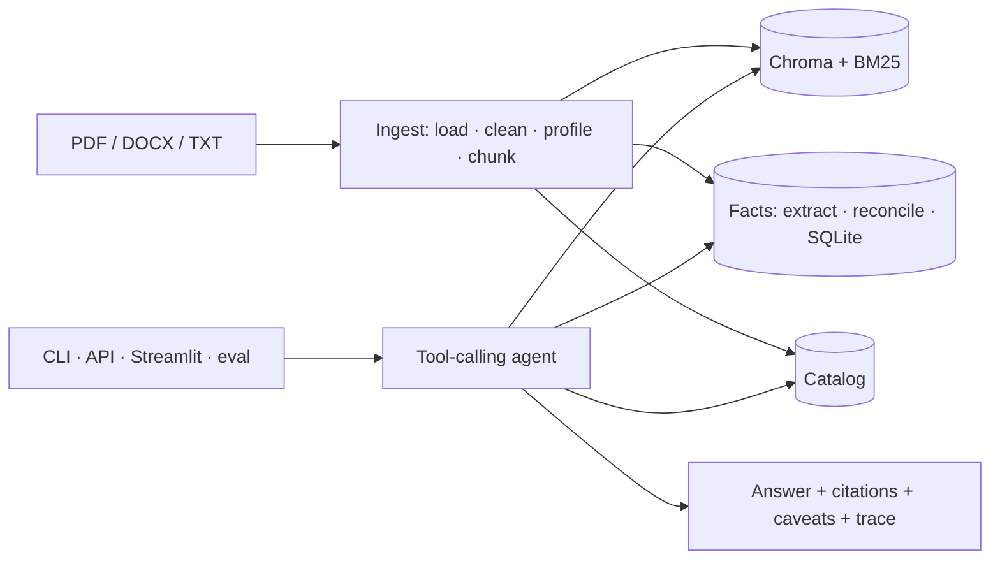

# annual-report-rag

A grounded, scalable RAG analyst assistant over automotive annual reports — built for the AECOM AI Engineer take-home. Ask it what Tesla earned in 2023, how BMW's revenue grew from 2017, or which of Tesla and Ford was more profitable in 2022, and it answers from the provided documents only: every figure comes from a verified, cited fact or passage; every calculation runs in Python; every answer carries the legal entity, fiscal year, currency, unit, caveats and a trace you can open with `/why`. Nothing about the dataset lives in code — the system discovered at ingest that "BMW 2022/2023" are the financing subsidiary's reports, that Ford's FY2023 PDF has a corrupt text layer, and that `news.pdf` is noise.



## Quickstart

```bash
make setup                      # Python 3.11 venv, CPU torch, pinned deps, .env from .env.example
# put OPENROUTER_API_KEY in .env
make ingest                     # profile + index + extract facts for data/raw (≈15 min, idempotent)
make chat                       # terminal demo; try /catalog, /facts Tesla revenue, /why, /model
make api                        # FastAPI on :8000  (curl localhost:8000/health)
make ui                         # Streamlit on :8501
make eval                       # golden set on both configured models → eval/reports/latest.md
make test lint                  # 70 unit tests, ruff
```

Docker (web app packaged as an image): `make docker-build && make docker-up`, then `docker compose run --rm api python scripts/ingest.py` once; API on :8000, UI on :8501.

## A short transcript

<!-- transcript:start -->
Recorded with `nvidia/nemotron-3-ultra-550b-a55b:free` (prompt versions {'extractor': '1', 'profiler': '1', 'system': '2'}), served verbatim by `python -m apps.cli chat --replay`.

**you ›** Between Tesla and Ford, which company achieved higher profits in 2022?

> **Tesla achieved higher profits in 2022.**  
> 
> | Company | Legal entity | FY2022 net income | Currency | Unit |
> |---------|--------------|-------------------|----------|------|
> | Tesla | Tesla, Inc. (group) | **12,587** | USD | millions |
> | Ford | Ford Motor Company (group) | **‑1,981** | USD | millions |
> 
> Tesla reported a net income of **USD 12,587 million** (a profit), while Ford reported a net loss of **USD 1,981 million**. Both figures are from the respective companies' group-level annual reports for FY2022 and are directly comparable because they are in the same currency (USD) and unit (millions).
> 
> **Conclusion:** Tesla was profitable in 2022; Ford recorded a loss. Therefore, Tesla achieved higher profits.
>
> **Sources:** [Tesla, Inc. FY2022 p.20], [Ford Motor Company FY2022 p.39]
> ⚠️ Both figures are group-level (consolidated) results from the primary issuer reports.
> ⚠️ No currency conversion needed; both in USD millions.

`10820/877 tokens · 16s · confidence high · tools: lookup_facts, lookup_facts, final_answer`
<!-- transcript:end -->

## How it works

| Stage | What happens | Where |
|---|---|---|
| Load | pdfplumber text + tables; duplicate text layers dropped before layout analysis | `core/ingestion/loaders/` |
| Clean | NFKC, doubled-glyph collapse, line dedup, running header/footer removal | `core/ingestion/cleaner.py` |
| Profile | LLM reads a sample + unit declarations → legal entity, group/subsidiary, FY, currency, unit, sector; code validates | `core/ingestion/profiler.py` |
| Chunk | page-bounded 800-char windows + Markdown table chunks, each headed `[entity | type FY | ccy unit | p.N]` | `core/ingestion/chunker.py` |
| Index | BGE-small embeddings in Chroma + BM25; reciprocal rank fusion; per-issuer round robin; page expansion | `core/index/` |
| Facts | retrieval picks statement pages → LLM extracts every (metric, year) with unit/currency → reconciliation across reports → SQLite + CSV | `core/facts/` |
| Agent | tools `list_catalog`, `search_documents`, `lookup_facts`, `compute_metric`, `final_answer`; citations verified in code; model knowledge off by default | `core/agent/` |
| Memory | SQLite sessions with slot memory (entities/years/metrics) for follow-ups | `core/agent/memory.py` |
| Observability | one trace per request (tool calls, ranks, facts, cost); `/why`; eval reads traces; replay cache for demos | `core/observability/` |

## Decisions (short form)

| Decision | Why |
|---|---|
| No LangChain/LlamaIndex | every line explainable; nothing hidden |
| Facts layer + RAG, not RAG alone | numeric answers need verified, cited numbers with unit and currency |
| Arithmetic in Python (`simpleeval`) | reproducible, provenance by fact id, currency mismatch refused |
| Hybrid retrieval with RRF; year never a hard filter | prior-year figures live inside later reports |
| LLM profiler + code validation | only a reader can tell a subsidiary's report from the group's |
| Protocols with one implementation | the seams are the scaling story (Qdrant, OpenSearch, Redis, Postgres) |
| Free OpenRouter models by default | owner's choice; `/model anthropic/claude-sonnet-5` works unchanged |

Full log with alternatives: [docs/DECISIONS.md](docs/DECISIONS.md).

## Evaluation

<!-- evaluation:start -->
Replayed answers (served from the replay cache): 2.

| cases | passed | numeric accuracy | behaviour accuracy | noise leaks | mean latency | mean tokens | total cost |
|---|---|---|---|---|---|---|---|
| 2 | 2 (100%) | 100% (2 cases) | 100% | 0 | 0.0s | 9492 | $0.0000 |

Full report: [eval/reports/report_nvidia-nemotron-3-ultra-550b-a55b-free_2026-10-11.md](eval/reports/report_nvidia-nemotron-3-ultra-550b-a55b-free_2026-10-11.md).
<!-- evaluation:end -->

Extraction accuracy against 46 hand-verified figures: see [eval/verification.md](eval/verification.md).

## Data audit

What the files really are and how each anomaly is handled generically: [docs/DATA_AUDIT.md](docs/DATA_AUDIT.md). Architecture, sequence diagrams and the scaling plan: [docs/ARCHITECTURE.md](docs/ARCHITECTURE.md). Demo script: [docs/DEMO.md](docs/DEMO.md).

## Limitations

- Figures are only as good as the extraction layer of the PDFs; the Ford files are 10-K *extracts* without income statements, so revenue/net income come from MD&A key-metric tables.
- EBITDA is in the registry but none of the 10-Ks report it — the assistant says so rather than deriving it.
- Free OpenRouter endpoints are rate-limited (50 requests/day without credits; upstream 429s happen); `--replay` exists for exactly this.
- No reranker, section-aware chunking, currency conversion or authentication (see roadmap).

## Roadmap (explicitly out of scope)

Reranker; Docling/Unstructured table-aware parsing; section-aware chunking; Qdrant/pgvector; Redis sessions; background ingestion jobs; authentication and multi-tenant isolation; currency conversion with FX data; fine-tuning; cloud deployment; prompt-injection hardening of document content; GraphRAG.

## Adding documents

Drop files under `data/raw/` (any folder structure; `.pdf`, `.docx`, `.txt`, `.md`) and run `make ingest`. New issuers, years, currencies and sectors are discovered; new metrics go in `core/facts/registry.yaml`.
