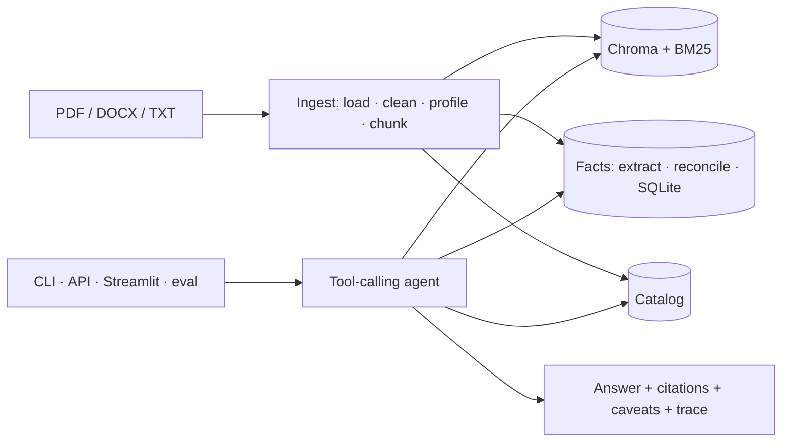

# annual-report-rag

A grounded, scalable RAG analyst assistant over automotive annual reports — built for the AECOM AI Engineer take-home. Ask it what Tesla earned in 2023, how BMW's revenue grew from 2017, or which of Tesla and Ford was more profitable in 2022, and it answers from the provided documents only: every figure comes from a verified, cited fact or passage; every calculation runs in Python; every answer carries the legal entity, fiscal year, currency, unit, caveats and a trace you can open with `/why`. Nothing about the dataset lives in code — the system discovered at ingest that "BMW 2022/2023" are the financing subsidiary's reports, that Ford's FY2023 PDF has a corrupt text layer, and that `news.pdf` is noise.



## Quickstart

```bash
make setup                      # Python 3.11 venv, CPU torch, pinned deps, .env from .env.example
# put OPENROUTER_API_KEY in .env
make rebuild                    # indexes + facts from the committed artefacts, ZERO model calls (≈5–15 min on CPU)
#  (or `make ingest` to re-profile and re-extract with the model: ≈70 calls, ≈15 min)
make ui                         # web chat at http://localhost:8501 (opens the browser): Chat · Catalog · Facts · Search
make chat                       # the same in the terminal; /catalog, /facts Tesla revenue, /why, /model
make api                        # FastAPI on :8000  (curl localhost:8000/health)
make eval                       # golden set on both configured models → eval/reports/latest.md
make test lint                  # 86 unit tests, ruff
```

The web chat shows, under every answer, the same explanation the CLI's `/why` prints: tool calls with their full results, retrieved chunks with both ranks and the fused score, the facts used, and the raw trace. Suggested questions sit above the chat; the sidebar switches model, toggles the labelled model-knowledge note and starts a new conversation.

Docker (web app packaged as an image): `make docker-build && make docker-up`, then `docker compose run --rm api python scripts/ingest.py` once; API on :8000, UI on :8501.

## A short transcript

Captured from a live session with `nvidia/nemotron-3-ultra-550b-a55b:free` (system prompt v2) on 2026-10-10. Every answer is produced live by retrieval → facts → model; wording varies between runs, figures and citations should not.

**you ›** What was Tesla's revenue in 2023?

> Tesla, Inc. (group) reported **revenue of USD 96,773 million** for FY2023 [Tesla, Inc. FY2023 p.20].
>
> **Sources:** [Tesla, Inc. FY2023 p.20]

`6803/485 tokens · 11s · confidence high · tools: lookup_facts, final_answer`

**you ›** And 2022?

> Tesla, Inc. (group) reported **revenue of USD 81,462 million** for FY2022 [Tesla, Inc. FY2022 p.20].
>
> **Sources:** [Tesla, Inc. FY2022 p.20]

`10839/535 tokens · 10s · confidence high · tools: lookup_facts, final_answer`

**you ›** And Ford?

> Ford Motor Company (group) reported the following revenue:
> 
> | Fiscal Year | Revenue (USD millions) |
> |-------------|------------------------|
> | 2022 | 158,057 |
> | 2023 | 176,191 |
> 
> - **FY2022**: USD 158,057 million [Ford Motor Company FY2022 p.39]
> - **FY2023**: USD 176,191 million [Ford Motor Company FY2023 p.44]
> 
> Both figures are from Ford Motor Company's group annual reports, reported in USD millions.
>
> **Sources:** [Ford Motor Company FY2022 p.39], [Ford Motor Company FY2023 p.44]
> ⚠️ Figures are in USD millions as reported by Ford Motor Company group; no currency conversion applied.

`12583/895 tokens · 15s · confidence high · tools: lookup_facts, final_answer`

---

**you ›** Between Tesla and Ford, which company achieved higher profits in 2022?

> **Tesla achieved higher profits in 2022.**  
> 
> | Company | Legal entity | FY2022 net income | Currency | Unit |
> |---------|--------------|-------------------|----------|------|
> | Tesla | Tesla, Inc. (group) | **12,587** | USD | millions |
> | Ford | Ford Motor Company (group) | **‑1,981** | USD | millions |
> 
> Tesla reported a net income of **USD 12,587 million** (a profit), while Ford reported a net loss of **USD 1,981 million**. Both figures are from the respective companies' group-level annual reports for FY2022 and are directly comparable because they are in the same currency (USD) and unit (millions).
> 
> **Conclusion:** Tesla was profitable in 2022; Ford recorded a loss. Therefore, Tesla achieved higher profits.
>
> **Sources:** [Tesla, Inc. FY2022 p.20], [Ford Motor Company FY2022 p.39]
> ⚠️ Both figures are group-level (consolidated) results from the primary issuer reports.
> ⚠️ No currency conversion needed; both in USD millions.

`10820/877 tokens · 16s · confidence high · tools: lookup_facts, lookup_facts, final_answer`

## How it works

| Stage | What happens | Where |
|---|---|---|
| Load | pdfplumber text + tables; duplicate text layers dropped before layout analysis | `core/ingestion/loaders/` |
| Clean | NFKC, doubled-glyph collapse, line dedup, running header/footer removal | `core/ingestion/cleaner.py` |
| Profile | LLM reads a sample + unit declarations → legal entity, group/subsidiary, FY, currency, unit, sector; code validates | `core/ingestion/profiler.py` |
| Chunk | page-bounded 800-char windows + Markdown table chunks, each headed `[entity | type FY | ccy unit | p.N]` | `core/ingestion/chunker.py` |
| Index | BGE-small embeddings in Chroma + BM25; reciprocal rank fusion; per-issuer round robin; page expansion | `core/index/` |
| Facts | retrieval picks statement pages → LLM extracts every (metric, year) with unit/currency → reconciliation across reports → SQLite + CSV | `core/facts/` |
| Agent | tools `list_catalog`, `search_documents`, `lookup_facts`, `compute_metric`, `final_answer`; citations verified in code; model knowledge off by default | `core/agent/` |
| Memory | SQLite sessions with slot memory (entities/years/metrics) for follow-ups | `core/agent/memory.py` |
| Observability | one trace per request (tool calls, ranks, facts, cost, answering model); `/why`; eval reads traces | `core/observability/` |

## Decisions (short form)

| Decision | Why |
|---|---|
| No LangChain/LlamaIndex | every line explainable; nothing hidden |
| Facts layer + RAG, not RAG alone | numeric answers need verified, cited numbers with unit and currency |
| Arithmetic in Python (`simpleeval`) | reproducible, provenance by fact id, currency mismatch refused |
| Hybrid retrieval with RRF; year never a hard filter | prior-year figures live inside later reports |
| LLM profiler + code validation | only a reader can tell a subsidiary's report from the group's |
| Protocols with one implementation | the seams are the scaling story (Qdrant, OpenSearch, Redis, Postgres) |
| Free OpenRouter models by default, automatic fallback model | owner's choice; a failed call (quota, outage, missing endpoint) is retried on `LLM_MODEL_FALLBACK` and the answer says which model replied; `/model anthropic/claude-sonnet-5` works unchanged |

Full log with alternatives: [docs/DECISIONS.md](docs/DECISIONS.md).

## Evaluation

<!-- evaluation:start -->
System prompt version(s) answered under: 2. Model fallback disabled for evals; every answer is live.

| cases | passed | numeric accuracy | behaviour accuracy | noise leaks | mean latency | mean tokens | total cost |
|---|---|---|---|---|---|---|---|
| 16 | 13 (81%) | 83% (12 cases) | 100% | 0 | 33.1s | 19872 | $0.0000 |

Full report: [eval/reports/report_nvidia-nemotron-3-ultra-550b-a55b-free_2026-10-12.md](eval/reports/report_nvidia-nemotron-3-ultra-550b-a55b-free_2026-10-12.md).
<!-- evaluation:end -->

Reading the partial run (2026-10-12, primary model, 50-calls/day free tier): 16 of the 22 golden cases ran before the daily cap stopped it; every behaviour check passed (answer / refuse / caveat) and no answer cited the news file. The three failures share one cause: the model closed `answer_markdown` after a lead-in sentence — "…the following key economic factors…:" — without writing the list or table it announced, while its conclusion, citations and caveats were right (q12, q13); q10 named the more profitable company but never computed and quoted the margins. Both are fixed in system prompt v3 (state every figure the conclusion rests on; profitability comparisons go through `compute_metric`) and an incomplete-answer guard in the agent loop that sends a truncated `final_answer` back once, unit-tested; they have not yet been re-evaluated because the cap was reached. `make eval` runs the full set on both models once calls are available (1,000/day with credits).

Extraction accuracy against 46 hand-verified figures: see [eval/verification.md](eval/verification.md).

## Data audit

What the files really are and how each anomaly is handled generically: [docs/DATA_AUDIT.md](docs/DATA_AUDIT.md). Architecture, sequence diagrams and the scaling plan: [docs/ARCHITECTURE.md](docs/ARCHITECTURE.md). Walkthrough with example questions: [docs/DEMO.md](docs/DEMO.md).

## Limitations

- Figures are only as good as the extraction layer of the PDFs; the Ford files are 10-K *extracts* without income statements, so revenue/net income come from MD&A key-metric tables.
- EBITDA is in the registry but none of the 10-Ks report it — the assistant says so rather than deriving it.
- Every answer is generated live; there are no canned responses. Free OpenRouter endpoints are rate-limited (50 requests/day without credits; upstream 429s happen), so the client falls back to `LLM_MODEL_FALLBACK` automatically and reports quota exhaustion in plain language. Ingestion state does not need the model: the committed `catalog.json` and `facts_export.csv` rebuild indexes and facts with `make rebuild`.
- No reranker, section-aware chunking, currency conversion or authentication (see roadmap).

## Roadmap (explicitly out of scope)

Reranker; Docling/Unstructured table-aware parsing; section-aware chunking; Qdrant/pgvector; Redis sessions; background ingestion jobs; authentication and multi-tenant isolation; currency conversion with FX data; fine-tuning; cloud deployment; prompt-injection hardening of document content; GraphRAG.

## Adding documents

Drop files under `data/raw/` (any folder structure; `.pdf`, `.docx`, `.txt`, `.md`) and run `make ingest`. New issuers, years, currencies and sectors are discovered; new metrics go in `core/facts/registry.yaml`.
