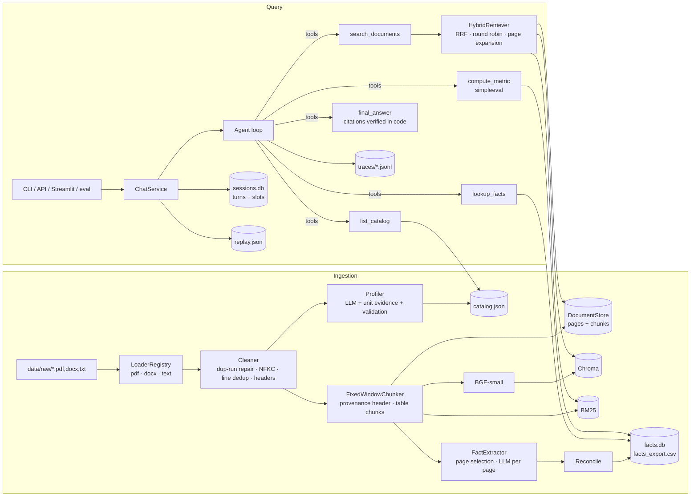

# Architecture

Two pipelines share one set of interfaces: **ingestion** (offline, idempotent, keyed on content hash) and **query** (online, a tool-calling agent over verified facts and hybrid retrieval). `core/service.py` composes everything; the CLI, API, Streamlit UI and eval harness only ever talk to `ChatService`.

## Component map



## Ingestion sequence

```mermaid
sequenceDiagram
  participant P as Pipeline
  participant L as Loader
  participant C as Cleaner
  participant M as LLM (profiler)
  participant K as Chunker
  participant I as Indexer
  participant X as FactExtractor
  participant G as Catalog
  P->>P: document_id = sha256(bytes)[:16]; skip if catalogued (unless --force)
  P->>L: load(path) → pages (text + tables); duplicate text runs dropped
  P->>C: clean_pages → NFKC, doubled-glyph collapse, line dedup, running headers removed
  P->>M: profile(first pages + middle page + first statements page + unit declarations)
  M-->>P: DocumentProfile (JSON schema) → validation rules (unit cross-check, flags)
  P->>K: chunk(pages, profile) → [header]+window text chunks, Markdown table chunks
  P->>I: embed + upsert (Chroma), add (BM25), save
  P->>X: select pages (retrieval votes + alias tables) → extract per page → raw facts
  X->>X: finalise: reconcile all raw facts → facts.db, facts_export.csv
  P->>G: add(profile, stats) → catalog.json
```

## Query sequence

```mermaid
sequenceDiagram
  participant U as User
  participant S as ChatService
  participant A as Agent
  participant LLM as LLM
  participant T as ToolBox
  U->>S: chat(session_id, "And 2022?")
  S->>S: load session (turns, slots); replay-cache lookup
  S->>A: run(session, message)
  A->>LLM: system (generated catalog summary) + condensed history + context slots + question, tools
  LLM-->>A: tool_calls: lookup_facts(issuer, metric, years)
  A->>T: run(lookup_facts) → facts with unit/currency/page/confidence + coverage
  A->>LLM: tool result (truncated; full copy in trace)
  LLM-->>A: tool_calls: compute_metric(yoy_growth, inputs={fact ids})
  A->>T: run(compute_metric) → value, formatted, caveats (currency check)
  LLM-->>A: tool_calls: final_answer(...)
  A->>T: build_answer: enrich citations from seen facts/chunks, drop unknown refs
  A-->>S: AgentAnswer + Trace (tool calls, retrieved, facts used, usage, latency)
  S->>S: append turns, update slots (entities/years/metrics), write trace
  S-->>U: answer + citations + caveats + footer
```

## Grounding guarantees (what code enforces, not the prompt)

| Guarantee | Enforced by |
|---|---|
| No answer without the `final_answer` tool | the loop only accepts a final answer through the tool; plain text is nudged, then `tool_choice` forces it |
| Citations refer to real tool results of this run | `ToolBox.build_answer` enriches from `seen_facts` / `seen_chunks` and drops anything else; answered-without-citation → confidence low + caveat |
| Arithmetic is Python | `compute_metric` evaluates registry formulas with `simpleeval` over fact ids; inputs must be facts |
| No cross-currency arithmetic | `CurrencyMismatch` raised in `compute`; the tool returns a structured error the model must relay |
| Entity awareness | catalog summary in the system prompt is generated from profiles; facts are keyed by legal entity; `lookup_facts` returns entity types |
| Model knowledge off by default | flag injected in the prompt; `model_knowledge_note` is nulled in code unless enabled |
| Everything traceable | one `Trace` per request; full tool results under `traces/results/<trace>/<step>.json`; `/why` renders it |

## Scaling

| Scale | What changes | Which seam |
|---|---|---|
| **10× documents (≈100)** | Nothing structural. Ingestion is per-file and idempotent; run it in parallel per file. Profiling cost ≈ 1 call/document; extraction ≈ 6–10 calls/document — cache by content hash (done). | — |
| **100× (≈1,000)** | BM25 rebuild-on-add becomes slow → swap `BM25Index` for OpenSearch/Elasticsearch; Chroma is fine to ~1M chunks but single-node → swap `ChromaVectorStore` for Qdrant/pgvector. Move ingestion to a queue (the API's `/ingest` becomes "enqueue"). Add a cross-encoder reranker between RRF and the model. | `LexicalIndex`, `VectorStore`, `IndexStage` |
| **1,000× (≈10,000+)** | Shard indexes by issuer/sector; per-issuer round robin already keeps comparisons balanced. Facts store → Postgres with the same `FactStore` API; extraction as a scheduled batch with a cheaper model; the registry grows per sector (data, not code). | `FactStore`, `FactsStage`, registry YAML |
| **Multi-user** | Sessions → Redis/Postgres via `SessionStore`; traces → a log pipeline (same JSON); API behind auth; one `ChatService` per process is already stateless apart from caches. | `SessionStore`, `TraceStore` |
| **New domains (banks, retailers, non-English)** | Add metrics/aliases to `registry.yaml`; profiler already classifies sector/currency/unit/language; prompts are versioned files. No code change expected. | `registry.yaml`, prompts |
| **Better models / providers** | `LLMProvider` is OpenAI-compatible; `/model` switches per turn; price table and usage accounting per model. | `LLMProvider` |

## Repository layout

See `docs/EXECUTION_PLAN.md` §5 — the layout was implemented as specified, with two additions: `core/index/indexer.py` (the pipeline's index stage) and `core/observability/replay.py` (the replay cache), plus `eval/verified_facts.json` / `eval/verify_facts.py` for extraction verification.
